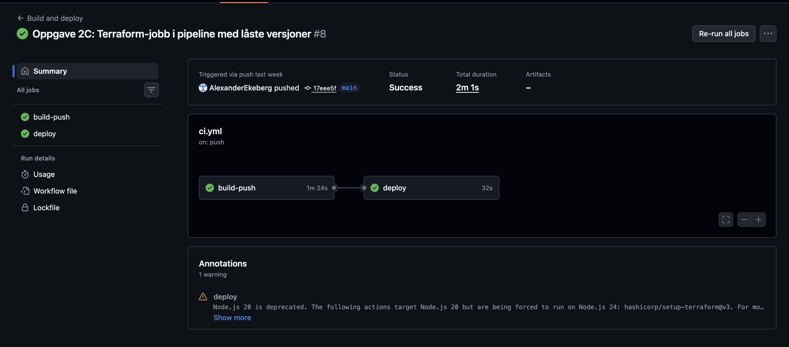
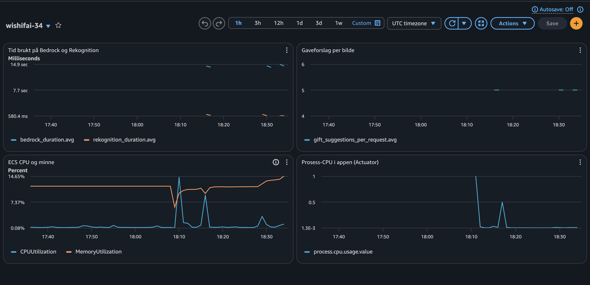

# PGR301 Eksamen 2026 – Kandidat 34

Forklarer hvorfor og hvordan jeg har tenkt når jeg løser oppgavene. 

## Oppgave 1A – Dockerfile

### Kjøre applikasjonen

AWS_ACCESS_KEY_ID og AWS_SECRET_ACCESS_KEY må være satt i terminalen, siden appen bruker S3, Rekognition og Bedrock.

```bash
docker build -t wishifai .
docker run --rm -p 9999:8080 -e AWS_ACCESS_KEY_ID -e AWS_SECRET_ACCESS_KEY -e AWS_REGION=eu-west-1 wishifai
```

Test:
```bash
curl -F "image=@samples/sample_image.png" http://localhost:9999/api/analyze
```

Dockerfilen bygger JAR-filen med Maven og JDK i første steg, og kopierer bare JAR-filen over til et lite JRE-image, slik at det endelige imaget blir mindre og uten build-verktøy.


## Oppgave 1B – CI-pipeline

Workflow: `.github/workflows/ci.yml`

Grønn kjøring: https://github.com/AlexanderEkeberg/pgr301-eksamen-34/actions/runs/41057448896

ECR-repoet ble opprettet manuelt med:
```bash
aws ecr create-repository --repository-name wishifai-34 --region eu-west-1
```

Hvert image tagges med commit-SHA-en, slik at man alltid kan se nøyaktig hvilken versjon av koden som kjører, og enkelt rulle tilbake til en tidligere versjon.


## Oppgave 2A – ECS Express med Terraform

Terraform-kode: `infra/`

URL: https://wi-e93f0f7ffdc34ed1b0ae62a2d151e2cf.ecs.eu-west-1.on.aws

Helsesjekk: https://wi-e93f0f7ffdc34ed1b0ae62a2d151e2cf.ecs.eu-west-1.on.aws/api/health

Test:
```bash
curl -F "image=@samples/sample_image.png" https://wi-e93f0f7ffdc34ed1b0ae62a2d151e2cf.ecs.eu-west-1.on.aws/api/analyze
```

Tjenesten bruker de eksisterende execution og infrastructure-rollene, og task-rollen wishifai-task-role-34 gir appen tilgang til S3, Rekognition og Bedrock. S3_BUCKET settes automatisk fra bucket-ressursen.


## Oppgave 2B – Remote state

State-nøkkel: wishifai/34/terraform.tfstate i bucketen pgr301-terraform-state

State lagres i S3 slik at pipelinen og andre utviklere bruker samme state.


## Oppgave 2C – Terraform i pipeline

Grønn kjøring: https://github.com/AlexanderEkeberg/pgr301-eksamen-34/actions/runs/41340040292



Terraform kjører etter build fordi den trenger den nye image-taggen, og imaget må ligge i ECR før ECS kan starte det.

Valgte å låse runner, Terraform og AWS-provideren slik at pipelinen gir samme resultat hver gang.


## Oppgave 3A – Metrikker

Metrikkene ligger i WishifaiMetrics.java og sendes til CloudWatch i namespace wishifai-34.

- `rekognition_duration` (Timer) måler tiden Rekognition-kallet tar.
- `bedrock_duration` (Timer) måler tiden Bedrock-kallet tar.
- `gift_suggestions_per_request` (DistributionSummary) er business-metrikken og viser hvor mange gaveforslag hvert bilde gir, i tillegg til totalt antall forslag og antall bilder analysert.
- `bedrock_parse_failures` (Counter) teller hvor ofte Bedrock svarer i et format appen ikke kan lese, som sier noe om kvaliteten på LLM-svarene.

Målingene viste at Bedrock tar rundt 15 sekunder mens Rekognition tar under 1 sekund, så det er Bedrock som gjør tjenesten treg.


## Oppgave 3B – Dashboard og alarm

Dashboard: wishifai-34 i CloudWatch

Her ligger Terraform-kode: infra/dashboard.tf og infra/alarm.tf

Jeg har lagt med et bilde: 

- Business: gift_suggestions_per_request viser hvor mange gaveforslag hvert bilde gir.
- Infrastruktur: CPU og minne for ECS-tjenesten, for å se om containeren har nok ressurser.
- Applikasjon: process.cpu.usage fra Spring Boot Actuator viser hvor mye CPU selve appen bruker.
- I tillegg vises bedrock_duration og rekognition_duration side om side, slik at man ser hvor tiden går.


### Alarm
wishifai-34-bedrock-slow går hvis Bedrock bruker mer enn 30 sekunder i snitt i 3 minutter på rad. Bedrock tar normalt rundt 15 sekunder og er den tregeste delen av tjenesten, så 30 sekunder betyr at noe er galt. Kravet om 3 perioder gjør at ett enkelt tregt kall ikke utløser alarmen.


## Oppgave 4 – Drøfting 